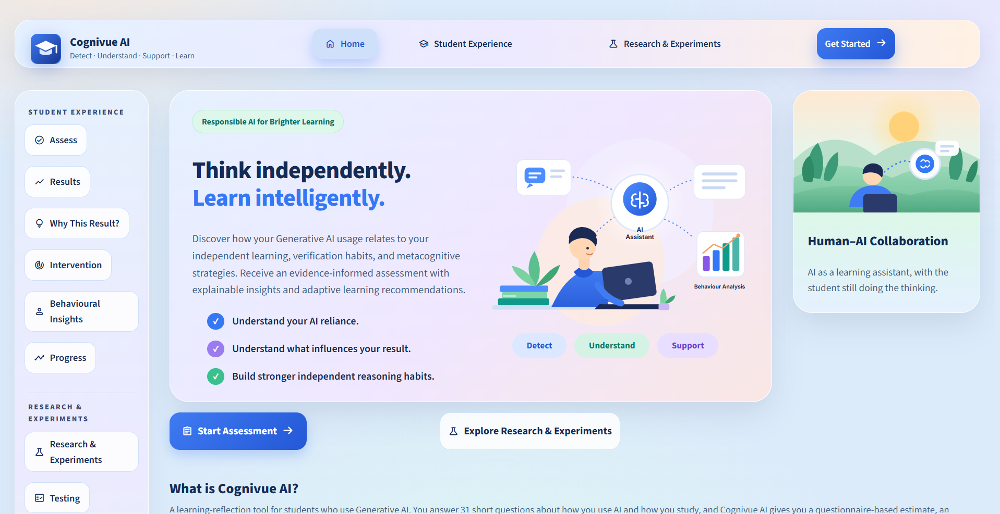
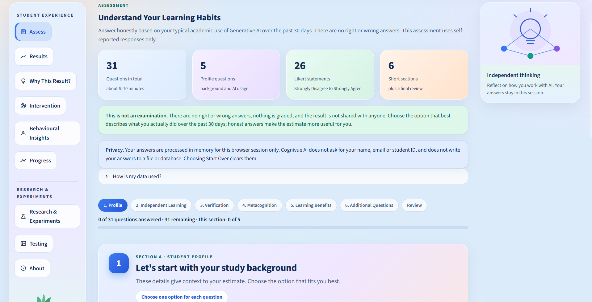
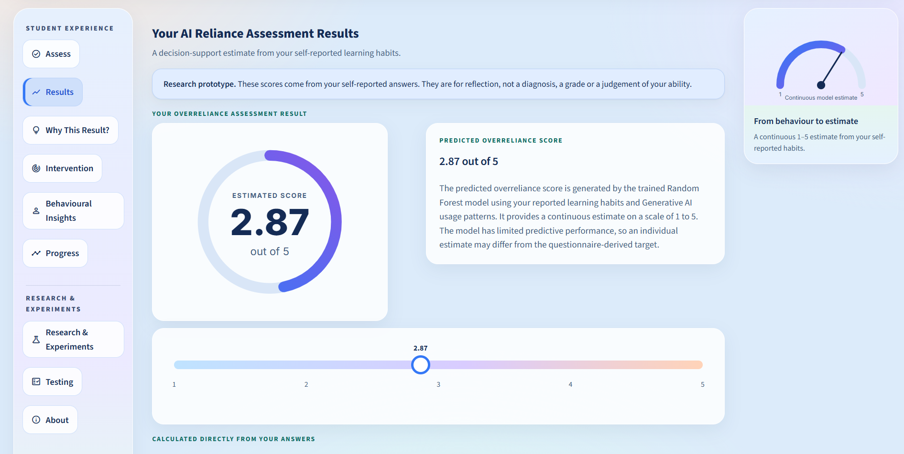
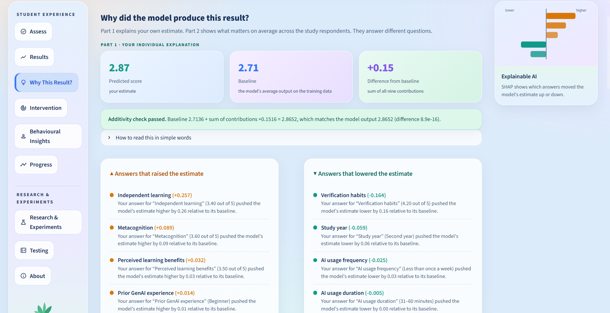
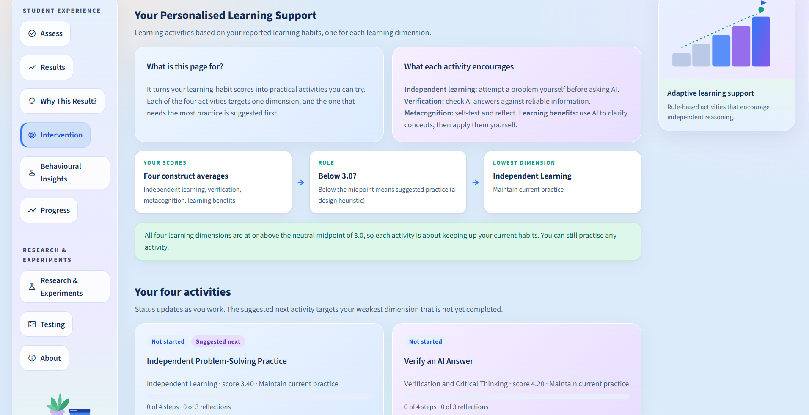
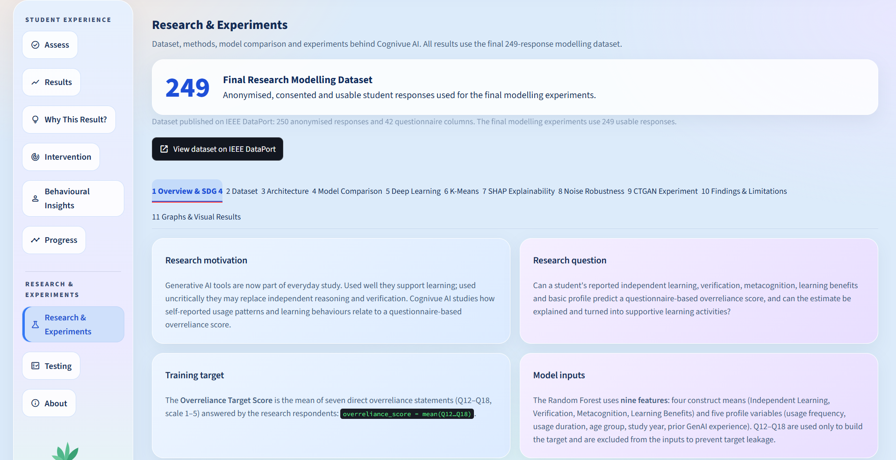

# 🧠 Cognivue AI

<div align="center">

[](https://www.python.org/)
[](https://streamlit.io/)
[](https://scikit-learn.org/)
[](https://shap.readthedocs.io/)
[](https://plotly.com/)
[](https://www.docker.com/)
[](https://render.com/)
[](LICENSE)

**🎯 An AI-based framework that detects potential Generative AI overreliance in students and guides them toward independent, verified and reflective learning**

*Detect · Understand · Support · Learn — Think independently. Learn intelligently.*

[Live Demo](https://cognivue-ai-t2n5.onrender.com/) · [Dataset (IEEE DataPort)](https://doi.org/10.21227/sf15-b979)

</div>

---

## 🌟 Project Highlights

> **Understand how you use GenAI**: Answer a short questionnaire and get an explainable estimate of your GenAI overreliance, your learning-habit profile and a personalised set of practice activities — all in one place.

**🎯 What makes this special:**
- **Explainable by design** - Every score comes with a per-student SHAP explanation and an additivity check
- **Research-backed** - Built on a consented dataset of **249 student responses** published on IEEE DataPort
- **No leakage** - The seven overreliance items (Q12–Q18) that define the target are never used as model inputs
- **Supportive, not judgemental** - Rule-based activities, no diagnostic labels, a clear research disclaimer
- **Privacy-first** - Answers stay in the browser session; nothing is stored, logged or sent to a database
- **Honest reporting** - Cross-validated metrics, baselines, limitations and an explicit "not clinical" notice
- **Production-ready** - Dockerised, integrity-checked model loading and 100+ automated tests

---

## 🚀 Key Features

### 🧭 **Assess → Understand → Improve**
A 31-question assessment turns your answers into four learning dimensions and one overall estimate:
- **Independent Learning** - Do you try problems yourself before asking AI?
- **Verification & Critical Thinking** - Do you check AI answers against reliable sources?
- **Metacognition** - Do you monitor and test your own understanding?
- **Learning Benefits** - Do you use AI to genuinely understand concepts?

### 🔍 **Explainable Predictions**
* **Predicted Overreliance Score** - A continuous 1–5 estimate from a Random Forest regressor
* **Why This Result?** - Per-student SHAP explanation showing what raised or lowered your estimate
* **Additivity check** - Baseline + SHAP contributions are verified against the model output
* **Behavioural Insights** - Four construct scores, exploratory K-Means group and PCA view

### 🧪 **Adaptive Interventions**
* **Rule-based recommendations** - Targeted support for any construct scoring below the 3.0 midpoint
* **4 interactive activities** - Independent problem-solving, answer verification, self-testing and active learning
* **Guided steps** - Text tasks, checkboxes, 1–5 self-ratings and written reflection questions
* **Next-activity logic** - Suggests the weakest construct you have not yet completed

### 📊 **Progress & Reports**
* **Attempt history** - Compare your current attempt with the previous one (derived scores only)
* **PDF report** - Download your scores, interpretation, reflections and K-Means note (ReportLab)
* **Progress files** - Size-limited, schema-validated uploads to continue later

### 🔬 **Research & Experiments Hub**
* **11 sections** - Overview and SDG 4, IEEE DataPort dataset, research architecture, eight-model comparison, deep learning, K-Means, SHAP, noise robustness, CTGAN status, findings and limitations
* **9 numbered graphs** - Interactive Plotly charts, each labelled with its dataset version
* **Testing page** - Live view of the automated test results

---

## 🖼️ Application Preview

<div align="center">

### 🏠 **Home**
*Student-focused introduction with the Assess → Understand → Improve journey*



### 📝 **Assessment**
*31 questions: 5 profile items, 19 Likert statements and 7 additional questions*



### 📈 **Results**
*One predicted score, four learning-dimension cards, bar and radar charts*



### 🔍 **Why This Result?**
*Per-student SHAP explanation with additivity check*



### 🧪 **Interventions**
*Interactive activities with steps, ratings and reflections*



### 🔬 **Research & Experiments**
*Model comparison, SHAP, K-Means, noise robustness and more*



</div>

---

## 📚 Dataset

| Item | Value |
|---|---|
| Survey submissions collected | 274 (45 columns) |
| Consented and usable for modelling | **249** |
| Not consented (excluded) | 25 |
| Published on IEEE DataPort | 250 anonymised responses, 42 columns (CC-BY, DOI `10.21227/sf15-b979`) |
| Target | `overreliance_score` = mean of Q12–Q18 (scale 1–5) |
| Model inputs | **9 features** (4 construct scores + 5 encoded profile items) |

One published response (age "Prefer not to say") cannot be encoded by the existing model, so the modelling experiments use 249 responses. The survey-platform record is a different record and was not reconciled row by row.

### 🧩 **Features used by the model**

| Feature | How it is built |
|---|---|
| `independent_learning_score` | Mean of Q19, Q20, Q22a, Q22b, Q23 |
| `verification_score` | Mean of Q24–Q28 |
| `metacognition_score` | Mean of Q29–Q33 |
| `learning_benefit_score` | Mean of Q34, Q35, Q37, Q39 |
| `usage_frequency_encoded` | Never = 0 … Multiple times a day = 5 |
| `usage_time_encoded` | No use = 0 … More than 2 hours = 5 |
| `age_group_encoded` | 16–17 = 1 … Above 26 = 4 |
| `study_year_encoded` | First year = 1 … Fifth year or above = 5 |
| `experience_encoded` | No experience = 0 … Advanced = 3 |

> The app asks seven additional questions in a final section, but no score is calculated from them and they cannot change the prediction, SHAP or K-Means (this is covered by automated tests).

---

## 🔬 Methodology & Architecture

### 🛠️ **System Architecture**
```
┌─────────────────────────────────────────────────────────────┐
│                    Frontend (Streamlit UI)                   │
│  ┌──────────┐ ┌──────────┐ ┌──────────┐ ┌──────────────┐   │
│  │  Assess  │ │ Results  │ │ Explain  │ │ Interventions│   │
│  └──────────┘ └──────────┘ └──────────┘ └──────────────┘   │
└─────────────────────────────────────────────────────────────┘
                              │
                              │ Python function calls
                              ▼
┌─────────────────────────────────────────────────────────────┐
│                  Backend Logic (no Streamlit)                │
│  ┌────────────┐ ┌─────────────┐ ┌──────────┐ ┌──────────┐  │
│  │ Validation │ │Preprocessing│ │Prediction│ │   SHAP   │  │
│  └────────────┘ └─────────────┘ └──────────┘ └──────────┘  │
│  ┌────────────┐ ┌─────────────┐ ┌──────────┐ ┌──────────┐  │
│  │  K-Means   │ │Interventions│ │  History │ │PDF Report│  │
│  └────────────┘ └─────────────┘ └──────────┘ └──────────┘  │
└─────────────────────────────────────────────────────────────┘
                              │
                              │ joblib load + integrity checks
                              ▼
┌─────────────────────────────────────────────────────────────┐
│                  Saved Artefacts (/models)                   │
│   RandomForest · K-Means · Scaler · PCA · Feature Order      │
│              + metadata JSON (verified on load)              │
└─────────────────────────────────────────────────────────────┘
```

### 🎯 **Data Flow**
1. **Questionnaire** → 24 predictor answers validated strictly (no defaults, no neutral filling)
2. **Preprocessing** → Likert labels mapped to 1–5, four construct means and five ordinal encodings
3. **Prediction** → Saved Random Forest returns a continuous score, clipped to 1–5
4. **Explanation** → SHAP TreeExplainer decomposes the score and verifies additivity
5. **Profiling** → K-Means group derived from the saved centroids (exploratory)
6. **Guidance** → Constructs below 3.0 receive targeted activities; the rest get maintenance advice
7. **Output** → Results, charts, activities, progress and an optional PDF report

### 🤖 **Modelling Workflow (249 responses)**
1. Consented responses are encoded and four construct scores are averaged from 19 Likert statements
2. The target is the mean of Q12–Q18; those seven items are **never** model inputs
3. Eight regression models were compared with repeated 5-fold cross-validation
4. The final `RandomForestRegressor` was refitted on all 249 responses and saved with the K-Means, scaler and PCA artefacts
5. The app only **loads** the saved models and verifies them against their metadata — it never retrains

| Random Forest setting | Value |
|---|---|
| Trees (`n_estimators`) | 149 |
| `max_depth` | 5 |
| `max_features` | 1.0 |
| `max_samples` | 0.8 |
| `min_samples_leaf` / `min_samples_split` | 2 / 5 |
| `random_state` | 42 |

---

## 📈 Research Results

All results use the 249-response dataset with **internal validation only** (no external test set).

### **Predictive performance**

| Evaluation | MAE | RMSE | R² |
|---|---|---|---|
| Nested CV (5×3 outer, 4 inner) | 0.5286 | 0.6968 | 0.1952 |
| Repeated 5-fold ×3, Random Forest | 0.5329 | 0.6957 | 0.1971 |
| Mean baseline (same folds) | 0.6331 | 0.7860 | −0.0250 |

The Random Forest improves MAE by about **15.8%** over the mean baseline.

### **Eight-model comparison** *(repeated 5×5 CV, MAE)*

| Model | MAE |
|---|---|
| Gradient Boosting | 0.5362 |
| Random Forest | 0.5368 |
| Support Vector Regression | 0.5374 |
| K-Nearest Neighbours | 0.5464 |
| Lasso | 0.5937 |
| Ridge | 0.5952 |
| Linear Regression | 0.5955 |
| Dummy Regressor | 0.6352 |

> The top three are practically tied, so the Random Forest is **not** claimed to be clearly best. It was chosen for its fit with small tabular data and its SHAP (TreeExplainer) integration.

### **Deep Learning vs Random Forest** *(identical RepeatedKFold 5×3 folds)*

| Model | MAE | RMSE | R² |
|---|---|---|---|
| Random Forest | 0.5329 | 0.6958 | 0.1969 |
| Deep Learning (Dense 32 → 16 → 8 → 1) | 0.5763 | 0.7421 | 0.0780 |

The network performed worse and is not deployed.

### **SHAP – global feature importance**

| Feature | Share of mean \|SHAP\| |
|---|---|
| Independent learning | 39.98% |
| Verification | 17.53% |
| Study year | 13.80% |
| Metacognition | 9.09% |
| AI usage frequency | 8.38% |
| Prior GenAI experience | 4.83% |
| Learning benefits | 3.24% |
| AI usage duration | 2.59% |
| Age group | 0.58% |

### **K-Means behavioural groups** *(exploratory)*
- **K = 2**, silhouette **0.3618**, PCA variance retained **79.21%**
- Group sizes: **195 (78.3%)** and **54 (21.7%)**
- Groups are descriptive "stronger" and "developing" learning-strategy profiles — **not** diagnostic categories

### **Reliability & correlations**

| Scale | Cronbach's α |
|---|---|
| Overreliance (Q12–Q18) | 0.8816 |
| Independent learning | 0.8538 |
| Verification | 0.8469 |
| Metacognition | 0.8839 |
| Positive learning benefits | 0.7640 |

| Spearman correlation with overreliance | ρ | p |
|---|---|---|
| Independent learning | −0.3491 | < 0.001 |
| Verification | −0.3340 | < 0.001 |
| Metacognition | −0.2634 | < 0.001 |
| Learning benefits | −0.0881 | 0.166 (n.s.) |
| Usage frequency | +0.1009 | 0.112 (n.s.) |
| Usage duration | +0.0839 | 0.187 (n.s.) |

### **Noise robustness** *(Random Forest)*
MAE rises only from **0.5214** (0% noise) to **0.5331** (30% noise); R² moves from 0.2251 to 0.1771.

### **CTGAN augmentation**
Only run on an earlier 151-response snapshot and **not repeated** on the final dataset. The app states this and shows no CTGAN numbers.

---

## ⚙️ Tech Stack

### **Application**
- **Streamlit 1.66** - Interactive web app and page router
- **Plotly 7.x** - Interactive bar, radar, PCA and research charts
- **ReportLab 5.x** - PDF report generation

### **Machine Learning & Explainability**
- **scikit-learn 1.6.1** - Random Forest, K-Means, StandardScaler, PCA
- **SHAP 0.51** - TreeExplainer for per-student explanations
- **joblib** - Loading saved model artefacts
- **NumPy 2.2 / pandas 2.2 / SciPy 1.17** - Numerical and tabular processing

### **Deployment & Quality**
- **Python 3.11** - Pinned runtime
- **Docker** - Reproducible, non-root container with a health check
- **Render** - Hosting (health check path `/_stcore/health`)
- **Custom test suites** - Backend pipeline, features, model loader and full app-flow tests

---

## 🗂️ Project Structure

```text
app.py                  Streamlit entry point and page router
backend/                LOGIC (never imports Streamlit)
  questionnaire.py        exact question wording, options and encodings
  validation.py           strict validation of the 24 predictor answers
  direct.py               helper for the seven additional answers (not used by the model)
  preprocessing.py        answers -> 4 construct scores + 5 encodings -> 9 features
  model_loader.py         loads saved models and verifies them against metadata
  prediction.py           Random Forest prediction (clipped to 1-5)
  explainability.py       per-student SHAP with additivity check
  clustering.py           K-Means groups derived from saved centroids
  interventions.py        rules, interactive activities and progress logic
  history.py              attempts over time (derived scores only)
  report.py               PDF report (ReportLab)
  evaluation.py           out-of-fold predictions loader
  research_data.py        verified experiment results
ui/                     SCREENS (every file imports Streamlit)
  home.py assessment.py results.py explain.py interventions.py profile.py
  progress.py research_experiments.py research_graphs.py testing.py about.py ...
models/                 saved models + metadata (refitted on 249 respondents)
assets/                 research architecture diagram
.streamlit/config.toml  theme
test_*.py               automated test suites
Dockerfile · render.yaml · requirements.txt
```

> `backend/interventions.py` (rules and activity logic) and `ui/interventions.py` (the page) are different files.

---

## 🎯 Usage Guide

### **1. Take the Assessment**
1. Open **Assess** from the navigation bar
2. Answer the profile questions and 19 Likert statements
3. Answer the 7 additional questions
4. Review your answers and click **Submit**

### **2. Read Your Results**
1. See your **Predicted Overreliance Score** (1–5)
2. Check the four learning-dimension cards and radar chart
3. Compare with your previous attempt, if any

### **3. Understand the Why**
1. Open **Why This Result?** for the SHAP explanation
2. See which factors raised or lowered your estimate
3. Visit **Behavioural Insights** for your K-Means group and PCA view

### **4. Improve with Activities**
1. Open **Intervention**
2. Start the recommended activity for your weakest construct
3. Complete the steps, ratings and reflection questions
4. Download your **PDF report** from **Progress**

---

## 💻 Run Locally

**Requirements:** Python 3.11 (Windows PowerShell shown)

```powershell
# 1. Clone the repository
git clone https://github.com/arun-248/cognivue-ai.git
cd cognivue-ai

# 2. Create and activate a virtual environment
py -m venv venv
.\venv\Scripts\Activate.ps1

# 3. Install the pinned dependencies
py -m pip install -r requirements.txt

# 4. Start the app
py -m streamlit run app.py
```

The app opens at `http://localhost:8501`. No environment variables are required (`COGNIVUE_MODELS_DIR` can override the models folder).

### 🧪 **Run the tests**
```powershell
py test_model_loader.py
py test_pipeline.py      # preprocessing, model, SHAP, K-Means, model-loading safety
py test_features.py      # activities, PDF report, attempt history, evaluation loader
py test_app_flow.py      # the full student journey, every page, refresh and failure cases
```
The scripts write `test_results.json`, which the **Testing** page displays.

---

## 🐳 Deployment

### **Docker**
```bash
docker build -t cognivue-ai .
docker run -p 8501:8501 cognivue-ai
```

### **Render**
1. Push the repository to GitHub
2. Create a **Web Service** with **Runtime: Docker** at the repository root
3. Set the health check path to `/_stcore/health`
4. Choose **Manual Deploy → Clear build cache & deploy** after dependency changes
5. Open the live URL and complete one assessment end to end

> A free Render instance can take about a minute to wake up. `render.yaml` is an optional Blueprint.

---

## ⚠️ Important Notes

### **🔐 Privacy**
- No name, email or student ID is requested
- Answers stay in the browser session — not stored on the server, not written to a database, not logged
- PDF reports contain derived scores, not raw answers
- The hosting provider may keep standard technical server logs, which do not contain answers
- Avoid typing personal details into the free-text activity boxes

### **🚦 Limitations**
- Cognivue AI is a **decision-support research prototype**, **not** a clinical or psychological diagnosis
- Self-reported data from 249 respondents at one institution
- Moderate predictive performance (R² ≈ 0.20) with **internal validation only**
- Predicted scores tend to sit toward the middle of the 1–5 scale
- SHAP values and correlations describe the model and sample — they are **not causal**
- K-Means groups are exploratory, and the 3.0 intervention threshold is a heuristic
- The activities have **not** been experimentally validated
- Do not use the score for grading, penalties or disciplinary decisions

### **🌐 Browser Support**
- Chrome 90+
- Firefox 88+
- Safari 14+
- Edge 90+

---

## 🛠️ Troubleshooting

### **App won't start**
```powershell
# Check if port 8501 is in use
netstat -ano | findstr :8501

# Use a different port
py -m streamlit run app.py --server.port 8502
```

### **"Models could not be loaded"**
- Make sure the `models/` folder sits next to `app.py`
- Run `py test_model_loader.py` to see exactly which file fails verification
- Check the `COGNIVUE_MODELS_DIR` variable if you set one

### **scikit-learn version warning**
- The saved model was trained with scikit-learn **1.6.1**
- Reinstall the pinned versions: `py -m pip install -r requirements.txt`

### **Actual-vs-predicted plots are missing**
- They need a genuine `evaluation_predictions.csv` next to `app.py`
- The file must contain only `Actual` and `Predicted` columns (out-of-fold predictions)

### **Render app is slow on first load**
- Free instances sleep when idle; wait about a minute for the service to wake up

---

## 📈 Future Roadmap

### **Short-term Goals**
- [ ] Repeat CTGAN augmentation on the final 249-response dataset
- [ ] Formal feature-ablation and sensitivity analysis
- [ ] Uncertainty estimates and calibration for predictions
- [ ] Additional baseline models for comparison

### **Long-term Vision**
- [ ] External validation on other institutions, disciplines and education levels
- [ ] Controlled user study to test whether the activities improve learning behaviour
- [ ] Longitudinal tracking of independent learning, verification and metacognition
- [ ] Psychometric validation of the questionnaire and target definition
- [ ] Consent-based student–AI interaction data with fairness and privacy review
- [ ] Multi-language support and usability studies

---

## 🌍 Sustainable Development Goal

Cognivue AI contributes to **SDG 4 – Quality Education** by helping students use Generative AI as a learning tool rather than a substitute for their own reasoning, critical evaluation and self-directed learning.

---

## 🤝 Contributing

Contributions are welcome! Here's how you can help:

### **Reporting Bugs**
1. Check existing issues first
2. Create a detailed bug report
3. Include steps to reproduce
4. Add screenshots if possible

### **Suggesting Features**
1. Open a discussion on GitHub
2. Describe the feature clearly
3. Explain the use case
4. Consider implementation complexity

### **Pull Requests**
1. Fork the repository
2. Create a feature branch (`git checkout -b feature/AmazingFeature`)
3. Run all four test scripts before committing
4. Commit changes (`git commit -m 'Add AmazingFeature'`)
5. Push to the branch (`git push origin feature/AmazingFeature`)
6. Open a Pull Request

---

## 📄 License

This project is licensed under the **MIT License** - see the [LICENSE](LICENSE) file for details.

The questionnaire dataset is published on IEEE DataPort under **CC-BY**.

---

## 📝 Citation

If you use this work, please cite the project and dataset:

```text
C. Arun, D. Kanna G, V. Chandran A, and S. K. Thangavel,
"Cognivue AI: AI-Based Framework for Detecting Generative AI Overreliance
and Providing Adaptive Interventions," Amrita Vishwa Vidyapeetham, Coimbatore, India.

Dataset: "Generative AI Usage, Overreliance, and Learning Behaviour Among Students:
A Questionnaire-Based Dataset," IEEE DataPort, doi: 10.21227/sf15-b979.
```

---

## 🙏 Acknowledgments

- **Amrita Vishwa Vidyapeetham, School of Computing (Coimbatore)** - For the academic setting and guidance
- **Dr. Senthil Kumar Thangavel** - For project supervision
- **The 249 student respondents** - For consenting to share their responses
- **IEEE DataPort** - For hosting the dataset
- **SHAP, scikit-learn and Streamlit teams** - For outstanding open-source tools
- **Plotly and ReportLab** - For charts and PDF reporting
- **Render** - For hosting the live demo

---

## 👥 Team

**Team Cognivue AI** — M.Tech Artificial Intelligence, Amrita Vishwa Vidyapeetham, Coimbatore

| Name | Focus |
|---|---|
| **C Arun** | Machine learning, risk prediction, adaptive intervention, dataset, methodology, application |
| **Vipin Chandran A** | GenAI trust, reliance, academic engagement and learning behaviour |
| **DhanushKanna G** | AI dependency, student attitudes and questionnaire-based statistical analysis |
| **Dr. Senthil Kumar Thangavel** | Project supervisor |

---

## 📞 Support

Having issues? We're here to help!

- 📧 Email: arunchinthalapally248@gmail.com
- 🐛 [Report Bug](https://github.com/arun-248/cognivue-ai/issues)
- 💡 [Request Feature](https://github.com/arun-248/cognivue-ai/issues)
- 🌐 [Live App](https://cognivue-ai-t2n5.onrender.com/)

---

<div align="center">

### 🌟 If you find this project helpful, please give it a star! ⭐

**Think independently. Learn intelligently. | Powered by Explainable AI 🚀**

[⬆ Back to Top](#-cognivue-ai)

</div>
